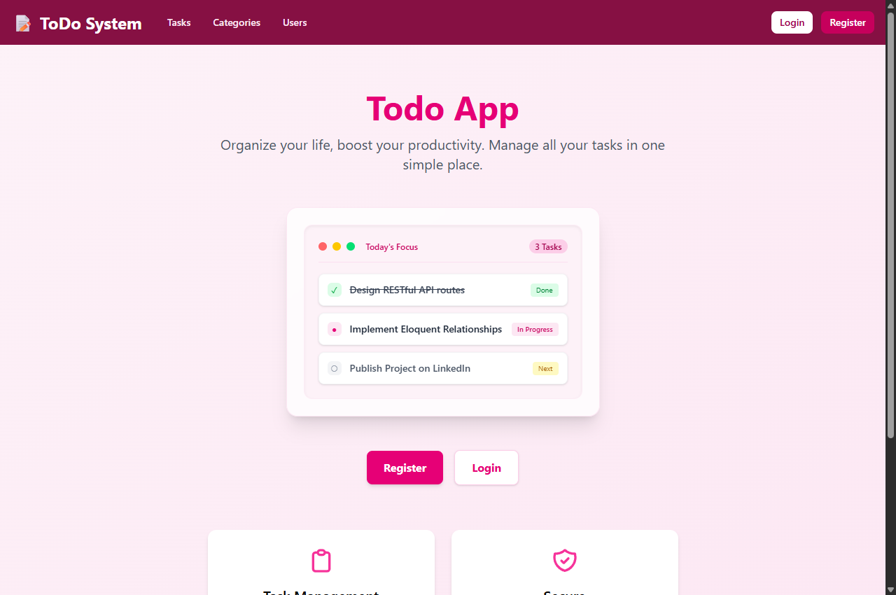
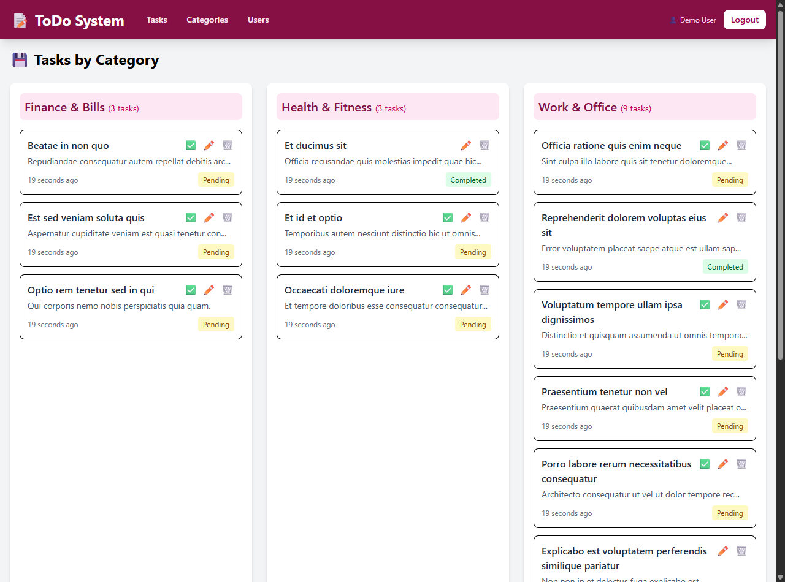
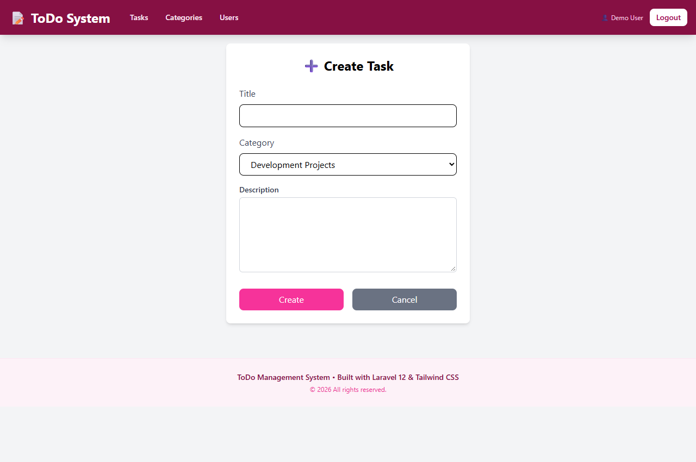
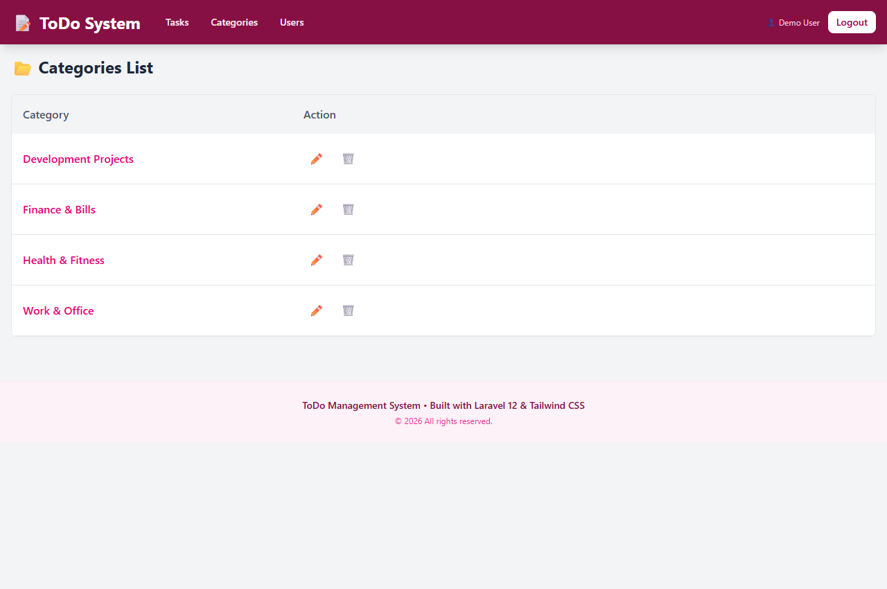
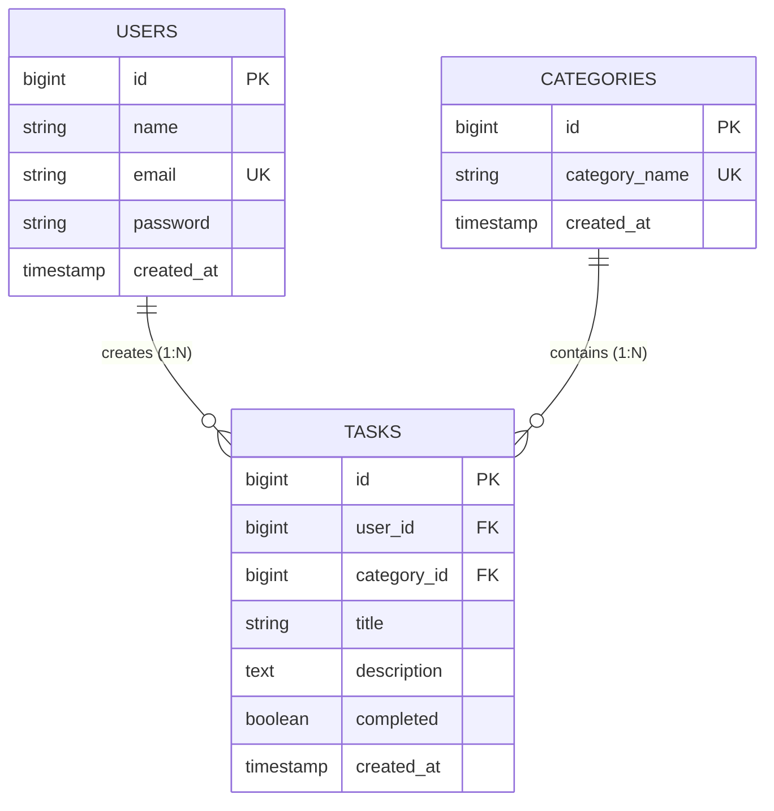

<h1 align="center">✨ Laravel ToDo & Task Management System</h1>

<p align="center">
  A clean, robust full-stack Task and Workflow Management web application built with <strong>Laravel 12</strong>, <strong>Tailwind CSS 4</strong>, and <strong>Blade Templating</strong> following MVC architecture and Laravel best practices.
</p>

<p align="center">
  
  
  
  
  
</p>

---

## 📸 Application Screenshots

<p align="center">
  <strong>1. Welcome & Landing Page</strong><br/>
  
</p>

<p align="center">
  <strong>2. Task Management Dashboard (Grouped by Category)</strong><br/>
  
</p>

<p align="center">
  <strong>3. Create New Task Form</strong><br/>
  
</p>

<p align="center">
  <strong>4. Category Management</strong><br/>
  
</p>

---

## 🚀 Key Features

- **🔐 Authentication & User Registration:**
  - Secure authentication flow with session handling and password hashing.
  - User registration with unique email validation and instant login.
- **📋 Task Management (Full CRUD):**
  - Create, view, edit, and delete tasks with assigned categories.
  - One-click task completion status toggle (`Pending` ↔ `Completed`).
  - Tasks grouped cleanly by categories with live task counts.
- **🏷️ Category Organization:**
  - Dynamic category creation and management with relational cascade constraints.
- **👥 User Administration:**
  - Paginated user listing and user detail views showcasing assigned tasks.
- **⚡ Performance & Clean Architecture:**
  - Optimized queries using Eloquent **Eager Loading** (`with('tasks')`) to prevent N+1 issues.
  - Structured **Form Requests** (`StoreTaskRequest`, `UpdateTaskRequest`, `StoreUserRequest`, etc.) for robust input validation.
  - Controller-level middleware protection via Laravel 12's `HasMiddleware`.
- **🌱 Automated Seeding & Factories:**
  - Pre-configured seeders and model factories to instantly generate realistic test environments.
- **🎨 Modern Responsive UI:**
  - Styled with **Tailwind CSS 4** and unified navigation across desktop and mobile devices.

---

## 🛠️ Tech Stack

- **Backend:** PHP 8.2+ / 8.4, Laravel 12 Framework
- **ORM & Database:** Eloquent ORM, SQLite / MySQL
- **Frontend:** Blade Templates, Tailwind CSS 4, Vite 6
- **Architecture:** MVC (Model - View - Controller), RESTful Resource Routing

---

## 📂 Database Schema & Relationships



---

## 🏁 Getting Started

Follow these steps to set up and run the project locally on your machine:

### 1. Clone the repository
```bash
git clone https://github.com/nargesss82/laravel_todo_list.git
cd laravel_todo_list
```

### 2. Install Dependencies
```bash
# Install PHP dependencies
composer install

# Install Node/npm dependencies
npm install
```

### 3. Environment Configuration
```bash
# Duplicate the example environment file
cp .env.example .env

# Generate application key
php artisan key:generate
```

### 4. Database Setup & Seeding
By default, the project works out of the box with SQLite (or MySQL by configuring `.env`):

```bash
# Run migrations and seed sample data
php artisan migrate --seed
```

### 5. Build Assets & Start Server
```bash
# Build frontend assets
npm run build

# Start local development server
php artisan serve
```

Now open [http://127.0.0.1:8000](http://127.0.0.1:8000) in your browser.

---

## 🔑 Default Test Credentials

For quick testing, you can use the seeded test account:

- **Email:** `test@example.com`
- **Password:** `password`

---

## 🤝 Contributing

Contributions, issues, and feature requests are welcome! Feel free to check the issues page or submit a PR.

---

## 📄 License

This project is open-sourced software licensed under the [MIT License](LICENSE).
